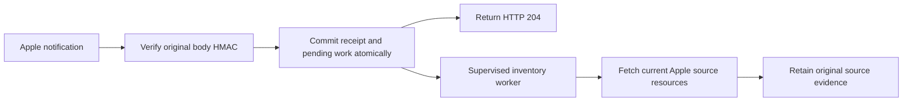

# AXM webhook notifications

The AXM library manages Apple subscriptions and verifies incoming notifications.
The reference server retains signed callbacks separately from inventory evidence and
queues fresh, targeted Apple reads. Existing native webhooks continue sending server
and MDM occurrences to external consumers.

## Library use

`axm.Client` provides `ListWebhooks`, `GetWebhook`, `CreateWebhook`, `UpdateWebhook`,
`DeleteWebhook`, `ListWebhookDeliveries`, `CreateWebhookDelivery` and
`CreateWebhookPing`. Lists return one page; `axm.Pages`, `NextPage` and `All` provide
explicit traversal. Create and update attributes preserve explicit false values.
Signing secrets are write-only. `Raw` preserves complete resource JSON.

Delivery queries require ordered `Start` and `End` timestamps. Set `IncludeEvent`
when inspecting event linkage; `EventFields` selects included attributes. Redelivery
references an existing delivery ID. Creation, ping and redelivery POSTs retain the
client's default policy of no transient-failure resubmission.

`axm.DecodeWebhookNotification(request, secret)` authenticates the original body
using `x-apple-signature`, bounds it to 1 MiB and preserves original bytes. The caller
owns body closure, HTTP responses, persistence and scheduling. Signatures do not prove
freshness: retain deduplication before acknowledging. `DeviceResourceID` reads the
actual orgDevices linkage and never substitutes the device serial.

## Reference server

Configure encrypted SQL storage and a named AXM account with Apple's webhook
permissions. Provision subscriptions explicitly through the admin API or CLI. Startup
never creates Apple subscriptions. `public_url` is the public HTTPS server origin;
when omitted, the configured enrollment public URL supplies it. Apple POSTs to
`/axm/notifications/{binding}`. The binding identifier selects a signing key and is
not authentication.

Admin routes below are relative to `/admin/v1/axm/accounts/{account}`:

| Route | Purpose | Authority |
|---|---|---|
| GET `/webhooks` | List Apple subscriptions | readBusinessManager |
| POST `/webhooks` | Create local intent and an Apple subscription | manageAxMAccounts |
| GET/PATCH/DELETE `/webhooks/{binding}` | Read or change this managed subscription | Read: readBusinessManager; mutations: manageAxMAccounts |
| GET `/webhooks/{binding}/deliveries?start=...&end=...` | Delivery metadata | readBusinessManager |
| GET deliveries with `raw=true` | Included events and remote diagnostic bodies | Also readRawInventory |
| POST `/webhooks/{binding}/ping` | Request signed ping | manageAxMAccounts |
| POST `/webhooks/{binding}/redeliver` | Replay a delivery belonging to this subscription | manageAxMAccounts |
| POST `/webhooks/{binding}/rotate` | Change signing secret | manageAxMAccounts |
| GET `/webhook-bindings` or `/webhook-bindings/{binding}` | Local provisioning and connectivity metadata | readBusinessManager |
| GET `/webhook-bindings/{binding}/receipts` | Safe receipt and job metadata | readBusinessManager |
| GET receipt path with `/raw` suffix | Exact retained callback bytes | readRawInventory |
| POST `/webhook-bindings/{binding}/reconcile` | Attach a verified Apple subscription after an uncertain outcome | manageAxMAccounts |

Create JSON uses `name`, `enabled`, `event_types`, and optionally `public_url`.
PATCH uses Apple's attribute keys; callback URL and signing-key changes use the
managed lifecycle rather than arbitrary PATCH values. Redelivery JSON supplies
`template_id`, `start` and `end`. Rotation JSON supplies `overlap_seconds` between
zero and 86400. Reconciliation JSON supplies `remote_id`; the server verifies that
Apple's callback URL matches this local binding.

The returned binding ID addresses managed routes; Apple's remote ID is separate.
`dmctl axm webhooks` supports `list`, `create`, `get`, `update`, `delete`, `bindings`,
`status`, `receipts`, `deliveries`, `ping`, `redeliver`, `rotate` and `reconcile`.
Supply `-account`; single-binding verbs also require `-binding`. Mutation JSON is
read through `-file`, with stdin as the default. Delivery reads require `-start` and
`-end`; `-raw` requests separately authorized payloads.

## Receipt, recovery and refresh



An authenticated callback and its pending refresh work commit atomically before
HTTP 204. Identical repeated IDs are harmless; different bytes under an existing ID
are rejected. A storage or binding-state failure returns a retryable failure.
Account incarnation, revision and current binding state fence acceptance and work.
Unknown notification types or schema versions retain receipt without executing refresh.

Device and migration notifications refresh detail. Assignment notifications refresh
detail and assigned service. Warranty notifications traverse coverage completely
before replacing successful coverage evidence. Pings record connectivity only.
Queued requests coalesce; notifications received during active work retain a successor
job. A separate persisted queue prevents older full-sync workers from consuming
unknown targeted jobs during upgrades. Existing schedules still reconcile missed callbacks. Failed reads preserve prior
successful evidence. Callbacks never assign devices, infer absence or link hardware.

Inspect local binding state after a failed provisioning request. A lost remote reply
can leave Apple changed while local state remains provisioning or uncertain; do not
repeat creation blindly. Inspect Apple's subscriptions and reconcile a known remote
ID. After account configuration changes, stale bindings reject callbacks and require
new provisioning. Retire the old remote subscription explicitly through Apple
administration; a recreated account never inherits its binding. Signing-key overlap is bounded.

## Verification

Run AXM, inventory and server coordinator tests with race detection. The independent
`axmtest` fake records pending ping/redelivery attempts; `DeliverWebhook` explicitly
POSTs one signed attempt using caller-supplied HTTP trust. It never starts external
callbacks automatically. SQLite tests exercise sealed receipt storage and restart.

The actual SQL-backed receiver has an opt-in acceptance test:

```sh
# Supply APPLE_KEY_ID, APPLE_ISSUER_ID and APPLE_PRIVATE_KEY_PEM privately.
# APPLE_PRIVATE_KEY_PATH is an alternative to PEM contents.
AXM_WEBHOOK_E2E=true CLOUDFLARED_BIN=/absolute/path/to/cloudflared \
  go test -tags acceptance -race ./server/internal/app \
  -run '^TestAcceptanceAXMWebhooks$' -v -timeout 10m
```

Use a correctly labeled P-256 PEM key: PKCS#8 DER uses `PRIVATE KEY`; SEC1 DER
uses `EC PRIVATE KEY`. The test creates ephemeral encrypted SQLite state and a
loopback listener, waits for tunnel registration/public DNS/HTTPS readiness,
and removes its test subscription with an independent cleanup context. DNS
publication probes contain only the temporary public hostname.

Live acceptance is opt-in and requires private environment credentials and a temporary
public HTTPS receiver. Exercise all eight operations, verify signed ping/redelivery,
poll SUCCEEDED outcomes, delete only the test subscription and confirm GET 404.
Apple's stored ping payload can have an empty ID: correlate its nonzero creation
timestamp with the signed ping, while requiring the callback ID from ping creation
and the delivery's event relationship. Both date filters and event inclusion are
required for that inspection. A ping does not prove inventory refresh; demonstrate a
designated reversible lab change separately and retain cleanup evidence privately.

See [Apple's event/signature contract](https://developer.apple.com/documentation/apple-school-and-business-manager-api/understanding-apple-business-api-webhook-events),
[source collection](agentless-inventory.md), and [native outbound webhooks](webhooks.md).
